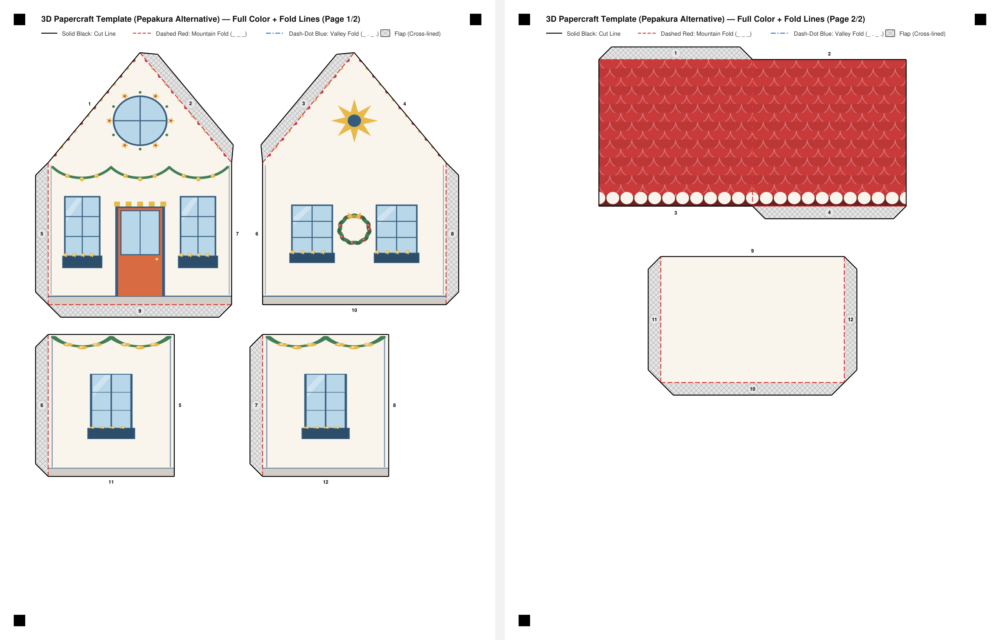

# Pepakura Alternative - 3D Papercraft Workflow Pipeline
### Universal Precision Template Generation for Manual Crafting & Cutting Plotters (Cricut / Silhouette / Brother)

---

## 1. Pipeline Overview & Specifications

This pipeline transforms **ANY 3D polygonal model (.obj or Blender mesh)** into production-ready papercraft templates following precision cutting plotter methodology and Pepakura Alternative standards:

* **Universal Compatibility**: Works with **any 3D object** (characters, props, vehicles, geometric polyhedra, organic low-poly meshes, and complex multi-part models).
* **Paper Format**: **US Letter** ($8.5 \times 11.0\text{ inches}$ / $215.9 \times 279.4\text{ mm}$) or **A4** ($210.0 \times 297.0\text{ mm}$).
* **Print Resolution**: **300 DPI** ($2550 \times 3300\text{ pixels}$ per page).
* **Page Margins**: Strict **$15.0\text{ mm}$ margin** from all 4 sheet edges ($X \in [15.0, 200.9]\text{ mm}$, $Y \in [15.0, 264.4]\text{ mm}$).
* **Part Clearance**: Strict **$\ge 5.0\text{ mm}$ gap** between all adjacent parts across all sheets.
* **Glue Flap Size**: Fully configurable in **millimeters (mm)** via CLI (`--flap-size <mm>`), Web Studio slider, and Blender panel (default: **$5.5\text{ mm}$**, range $2.0 - 20.0\text{ mm}$). 100% outward geometry with $45^\circ$ base angle, faint grey fill (`#E6E6E6`), and fine diagonal cross-lined diamond grip pattern (`#B8B8B8`, 2.2mm pitch).
* **Edge IDs**: Numbers on flaps are centered inside the tab body with a circular protective `#E6E6E6` badge. Numbers on mating cut edges sit **$2.5\text{ mm}$ outside the cut lines in scrap paper margins**—never printed over facet artwork.
* **Fold Line Distinction**:
  * **Mountain Folds**: Dashed Red (`#D32F2F`, stroke `6,2.5`).
  * **Valley Folds**: Dash-Dot Blue (`#1976D2`, stroke `8,3,2,3`).
  * **Cut Lines**: Solid Continuous Black (`#000000`, 0.4mm).
* **Optical Registration Marks**: $5\times 5\text{ mm}$ fiducial squares positioned for cutting plotter optical sensor alignment.

---

## 2. The 4 Workflow Variations

| # | Variation Name | Visual Configuration | Best Use Case & Crafter Workflow |
| :-: | :--- | :--- | :--- |
| **1** | **Full Color + Fold Lines** | Full Color/Texture + Fold Lines + Edge IDs | Guided assembly on white cardstock with crease guides. |
| **2** | **Full Color (No Lines)** | Full Color/Texture + Outlines Only (No Creases/IDs) | Seamless studio-grade exterior with clean facades. |
| **3** | **Blank White + Fold Lines** | Pure White Facets + Fold Lines + Edge IDs | Printing directly onto colored cardstock or hand painting. |
| **4** | **Blank White (No Lines)** | Pure White Facets + Clean Cut Outlines Only | Direct plotter blade cutting, spray painting, or tracing. |

---

## 3. Sample Output: Colored & Lined Template (300 DPI)

Below is the production output generated by the pipeline for **Variation 1 (Full Color + Fold Lines + Edge IDs)** on US Letter cardstock:

<p align="center">
  
</p>

* **Page 1 (300 DPI)**: [`examples/colored_and_lined_page1_300dpi.png`](examples/colored_and_lined_page1_300dpi.png) ($2550 \times 3300\text{ px}$)
* **Page 2 (300 DPI)**: [`examples/colored_and_lined_page2_300dpi.png`](examples/colored_and_lined_page2_300dpi.png) ($2550 \times 3300\text{ px}$)
* **Side-by-Side Verification Preview**: [`examples/colored_and_lined_preview.png`](examples/colored_and_lined_preview.png)

---

## 4. Universal Alternating Flap & Seam Matching Algorithm

The pipeline applies an automated topology solver to any arbitrary 3D mesh:

```
      [Part A: Flap Side]                     [Part B: Mating Side]
  ┌─────────────────────────┐               ┌─────────────────────────┐
  │                         │               │                         │
  │      Part Facet         │               │      Part Facet         │
  │                         │               │                         │
  └───────────┬─────────────┘               └─────────────────────────┘
      :       │ (Mountain Fold)                 ▲ (Clean Cut Outline)
    ┌─┴───────┴─┐                               :
    │  ▨ (1) ▨  │ (45° Cross-hatched Tab)       : [ID 1 in Scrap Margin]
    └───────────┘
```

1. **Seam Detection**: Every shared 3D edge between adjacent faces or UV boundary seams is identified and indexed ($1, 2, \dots, N$).
2. **Alternating Parity Rule**: For each mating pair of edges across cut boundaries, exactly **one edge** receives an outward glue tab ($45^\circ$ trapezoid, depth configured in mm), while the **mating edge** remains a clean cut line. Flaps alternate along the perimeter of connected islands to prevent physical tab collision.
3. **Dihedral Crease Classification**:
   * **Mountain Fold**: Convex 3D ridges (dihedral fold $< 180^\circ$, folding away from viewer) are marked with red dashed lines.
   * **Valley Fold**: Concave 3D troughs (dihedral fold $> 180^\circ$, folding toward viewer) are marked with blue dash-dot lines.
   * **Flat Fold Suppression**: Planar facets with angles within $175^\circ - 180^\circ$ have crease lines automatically suppressed.
4. **Protected Labeling**:
   * Glue tabs receive their seam ID enclosed in an `#E6E6E6` circular badge inside the tab body.
   * Mating edges receive their matching ID placed $2.5\text{ mm}$ outside the boundary in the scrap paper margin, ensuring 100% clean, pristine model surfaces after cutout.

---

## 5. How to Run the Pipeline

Clone the repository and install the minimal dependencies:

```bash
git clone https://github.com/parthwagh9999/pepakura-alternative.git
cd pepakura-alternative
pip install -r requirements.txt
```
*(Dependencies: `reportlab>=4.0.0`, `Pillow>=10.0.0`, `pymupdf>=1.23.0`)*

---

### Method A: Interactive Web Studio (`app.py`) ⭐ Recommended

Launch the interactive local web application (requires zero additional web frameworks):

```bash
python app.py
```
Then open **`http://localhost:8080`** in any web browser.

**Features:**
* **Drag-and-Drop 3D Upload**: Drag any `.obj` model file directly into the browser.
* **Live 3D Viewport**: Interactive 3D preview powered by Three.js (rotate, pan, zoom).
* **Flap Size Slider (mm)**: Real-time control of glue tab size in millimeters (2.0 mm to 20.0 mm).
* **Paper Format & Margins**: Toggle US Letter or A4, configure sheet margins in mm.
* **Instant Vector Preview**: Live interactive multi-sheet SVG viewer with tab navigation.
* **Direct Downloads**: One-click download buttons for Vector PDF, Layered Plotter SVG, and 300 DPI PNG.

---

### Method B: Universal Standalone Python CLI (`pepakura_alternative_workflow.py`)

Run the pipeline from terminal or command prompt with full parameter control:

```bash
# 1. Run on any 3D OBJ model with default flap size (5.5 mm)
python pepakura_alternative_workflow.py --input "path/to/my_model.obj"

# 2. Configure custom flap size in millimeters (e.g. 7.0 mm flaps)
python pepakura_alternative_workflow.py --input "my_model.obj" --flap-size 7.0

# 3. Specify custom texture image and output directory
python pepakura_alternative_workflow.py --input "my_model.obj" --texture "my_texture.png" --outdir "my_templates"

# 4. Switch paper format to A4 (default is US Letter)
python pepakura_alternative_workflow.py --input "my_model.obj" --format A4 --flap-size 6.0

# 5. Quick demo run (generates a geometric polyhedral papercraft model if no file is provided)
python pepakura_alternative_workflow.py
```

**CLI Options Reference:**
* `--input`, `-i`: Path to any 3D model file (`.obj`).
* `--flap-size`, `-s`: Depth/size of glue flaps in millimeters (default: `5.5` mm).
* `--format`, `-f`: Paper format: `LETTER` (default, 8.5x11 in) or `A4` (210x297 mm).
* `--texture`, `-t`: Path to texture image map (`PNG` or `JPG`).
* `--outdir`, `-o`: Output directory for generated deliverables (default: `exports`).

---

### Method C: Blender Add-on (`papercraft_plotter_tool.py`)

1. Open Blender (v4.0 to v5.2+).
2. Go to **Edit $\rightarrow$ Preferences $\rightarrow$ Add-ons $\rightarrow$ Install...** and select `papercraft_plotter_tool.py`.
3. Enable **Mesh: Pepakura Alternative & Plotter Papercraft Tool**.
4. In the 3D Viewport, select **ANY 3D Mesh**, press `N` to open the sidebar and navigate to the **Pepakura Alternative** tab.
5. In the sidebar panel:
   * Adjust **Flap Size (mm)** (default: 5.5 mm) and **Flap Base Angle** (45°).
   * Click **Clean & Planarize (Plotter Ready)** to snap non-planar quads and weld micro-gaps.
   * Click **Setup Geometry Nodes (Outward Tabs)** to visualize UV unwrap and tab extrusion in the viewport.
   * Click **Generate Pepakura Alternative Deliverables** to export all 4 variations for the active mesh.

---

## 6. Directory Structure

```
pepakura-alternative/
├── app.py                           # Interactive Web Studio (local web interface with 3D viewer)
├── pepakura_alternative_workflow.py # Universal standalone generator (CLI, all 4 variations, PDF/SVG/PNG)
├── papercraft_plotter_tool.py       # Blender Add-on with UI panel, mesh cleanup, & node generation
├── build_exact_nodes.py             # Script to build Geometry Nodes tree via Blender Python
├── requirements.txt                 # Python dependencies (reportlab, Pillow, pymupdf)
├── .gitignore                       # Clean ignore rules
├── README.md                        # Complete documentation featuring visual image showcase & guides
└── examples/
    ├── colored_and_lined_page1_300dpi.png # 300 DPI Sheet 1 (Full Color + Fold Lines + Edge IDs)
    ├── colored_and_lined_page2_300dpi.png # 300 DPI Sheet 2 (Full Color + Fold Lines + Edge IDs)
    └── colored_and_lined_preview.png      # Side-by-side verification preview
```

---

## 7. Current Scope, Limitations & Future Roadmap

> [!NOTE] Current Mesh Topology Scope
> The pipeline is currently **highly efficient for low-poly 3D models** and meshes where polygons are organized into planar groups or compact islands.
>
> In the current implementation:
> * Individual non-UV planar faces are unfolded into separate papercraft parts, each equipped with alternating perimeter glue tabs ($45^\circ$, depth in mm) and protected ID badges.
> * This guarantees **zero internal polygon self-intersection** and clean perimeter tab placement across any arbitrary mesh.

### 🔮 Future Roadmap:
* **Interactive Edge Joining & Splitting**: A visual, interactive tool to click edges and join adjacent polygons into contiguous compound nets, or split joined islands along specific crease seams (mirroring manual Pepakura seam-editing).
* **Automated Greedy Island Aggregator**: Advanced curvature-based heuristic solver to automatically stitch coplanar and nearly-coplanar adjacent polygons into compound printable nets.
* **Custom Flap Placement Overrides**: Ability to manually flip or override tab side assignments per individual edge.
