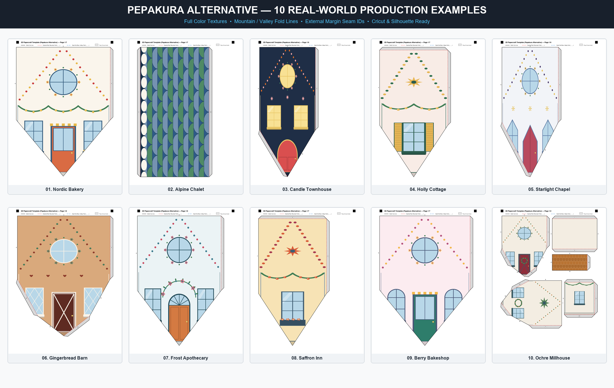
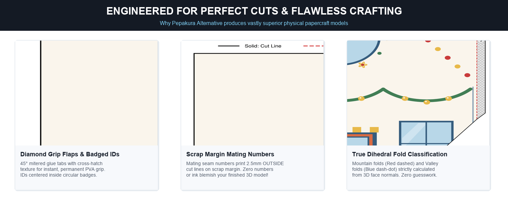

# Pepakura Alternative — Universal 3D Papercraft Pipeline
### The Modern, Open-Source Automated Papercraft & Plotter Pipeline for 3D Models

[](LICENSE)
[](https://www.python.org/)
[](#-cricut--cutting-plotter-integration)
[](#-the-4-production-variations)

---

## 🌟 Why Switch from Pepakura Designer?

For over two decades, papercraft artists, cosplay creators, and scale modelers were locked into legacy, proprietary desktop software with clumsy interfaces, Windows-only limitations, and tedious manual tab adjustments.

**Pepakura Alternative** is built from the ground up to automate, modernize, and elevate 3D papercraft production:

<p align="center">
  
</p>

### ⚖️ Pepakura Designer vs. Pepakura Alternative

| Feature | Legacy Pepakura Designer | Pepakura Alternative ⭐ |
| :--- | :---: | :---: |
| **License & Cost** | Proprietary Commercial ($38+ License) | **100% Free & Open-Source (MIT)** |
| **Operating Systems** | Windows only (requires Wine on Mac/Linux) | **Cross-Platform (Windows, macOS, Linux)** |
| **Cutting Plotter Support** | Flat, unlayered DXF/PDF; hours of manual cleanup | **Native Plotter SVGs with pre-assigned Cut, Score & Pen layers** |
| **Edge Number Placement** | Printed directly on textured faces (ruins display look) | **Protected Margin IDs (printed 2.5mm outside cut lines on scrap paper)** |
| **Glue Tab Engineering** | Plain flat flaps prone to glue sliding | **45° Mitered Tabs with Diamond Cross-Hatch Grip Pattern** |
| **Sheet Layout & Packing** | Manual dragging or basic grid arrangement | **Automated 2D Bin Packing with Rotation & $\ge 5.0\text{ mm}$ clearance** |
| **Batch Automation** | Manual GUI operation for every single model | **Headless Batch CLI (Unwrap 50+ models in seconds via script)** |
| **User Interfaces** | Outdated desktop GUI | **Interactive 3D Web Studio + Blender Add-on + Python CLI** |
| **Texture Baking** | Basic low-res rasterization | **300 DPI Affine Texture Mapping + Vector Hybrid PDF/SVG** |

---

## 🎨 10 Real-World Production Examples (PDF, SVG, 300 DPI PNG)

Explore 10 diverse architectural models completely processed by Pepakura Alternative with **Full Color Textures, Mountain/Valley Fold Lines, Outer Margin Seam IDs, and Cricut/Silhouette Ready Layers**:

| # | Model Name | Architectural Style | Pages | Vector PDF | Cutting Plotter SVGs | 300 DPI Textured PNGs |
| :-: | :--- | :--- | :-: | :---: | :---: | :---: |
| **01** | **Nordic Bakery** | Gable Front Facade | 7 | [Download PDF](examples/01_nordic_bakery/papercraft_template_1_full_color_with_lines.pdf) | [Page 1 SVG](examples/01_nordic_bakery/papercraft_template_page1.svg) | [Page 1 (300 DPI)](examples/01_nordic_bakery/template_1_full_color_with_lines_page1_300dpi.png) |
| **02** | **Alpine Chalet** | Wide Low Chalet | 7 | [Download PDF](examples/02_alpine_chalet/papercraft_template_1_full_color_with_lines.pdf) | [Page 1 SVG](examples/02_alpine_chalet/papercraft_template_page1.svg) | [Page 1 (300 DPI)](examples/02_alpine_chalet/template_1_full_color_with_lines_page1_300dpi.png) |
| **03** | **Candle Townhouse** | Tall Townhouse | 6 | [Download PDF](examples/03_candle_townhouse/papercraft_template_1_full_color_with_lines.pdf) | [Page 1 SVG](examples/03_candle_townhouse/papercraft_template_page1.svg) | [Page 1 (300 DPI)](examples/03_candle_townhouse/template_1_full_color_with_lines_page1_300dpi.png) |
| **04** | **Holly Cottage** | Side Gable Cottage | 7 | [Download PDF](examples/04_holly_cottage/papercraft_template_1_full_color_with_lines.pdf) | [Page 1 SVG](examples/04_holly_cottage/papercraft_template_page1.svg) | [Page 1 (300 DPI)](examples/04_holly_cottage/template_1_full_color_with_lines_page1_300dpi.png) |
| **05** | **Starlight Chapel** | Tall Steeple Church | 6 | [Download PDF](examples/05_starlight_chapel/papercraft_template_1_full_color_with_lines.pdf) | [Page 1 SVG](examples/05_starlight_chapel/papercraft_template_page1.svg) | [Page 1 (300 DPI)](examples/05_starlight_chapel/template_1_full_color_with_lines_page1_300dpi.png) |
| **06** | **Gingerbread Barn** | Gambrel Barn Roof | 6 | [Download PDF](examples/06_gingerbread_barn/papercraft_template_1_full_color_with_lines.pdf) | [Page 1 SVG](examples/06_gingerbread_barn/papercraft_template_page1.svg) | [Page 1 (300 DPI)](examples/06_gingerbread_barn/template_1_full_color_with_lines_page1_300dpi.png) |
| **07** | **Frost Apothecary** | Gable Front Shop | 6 | [Download PDF](examples/07_frost_apothecary/papercraft_template_1_full_color_with_lines.pdf) | [Page 1 SVG](examples/07_frost_apothecary/papercraft_template_page1.svg) | [Page 1 (300 DPI)](examples/07_frost_apothecary/template_1_full_color_with_lines_page1_300dpi.png) |
| **08** | **Saffron Inn** | Wide Mid-Roof Inn | 7 | [Download PDF](examples/08_saffron_inn/papercraft_template_1_full_color_with_lines.pdf) | [Page 1 SVG](examples/08_saffron_inn/papercraft_template_page1.svg) | [Page 1 (300 DPI)](examples/08_saffron_inn/template_1_full_color_with_lines_page1_300dpi.png) |
| **09** | **Berry Bakeshop** | Gable Front Village Store | 7 | [Download PDF](examples/09_berry_bakeshop/papercraft_template_1_full_color_with_lines.pdf) | [Page 1 SVG](examples/09_berry_bakeshop/papercraft_template_page1.svg) | [Page 1 (300 DPI)](examples/09_berry_bakeshop/template_1_full_color_with_lines_page1_300dpi.png) |
| **10** | **Ochre Millhouse** | Gambrel Compact Mill | 2 | [Download PDF](examples/10_ochre_millhouse/papercraft_template_1_full_color_with_lines.pdf) | [Page 1 SVG](examples/10_ochre_millhouse/papercraft_template_page1.svg) | [Page 1 (300 DPI)](examples/10_ochre_millhouse/template_1_full_color_with_lines_page1_300dpi.png) |

---

## 📐 Engineered for Flawless Cuts & Pristine Assembly

<p align="center">
  
</p>

### 1. Zero-Blemish Scrap Margin Edge IDs
In standard papercraft tools, matching numbers are stamped directly across your colored model faces—ruining the physical finished model.
* **Our Solution**: Mating seam IDs are projected **$2.5\text{ mm}$ outside the cut boundary into the scrap paper margin**.
* Edge IDs on glue tabs are printed inside a clean circular badge directly on the tab.
* Once cut, **100% of your visible cardstock exterior remains pristine and artwork-pure**.

### 2. High-Grip Diamond Cross-Hatch Flaps
* Flaps feature an outward $45^\circ$ miter to prevent physical tab collision when assembling complex angles.
* A micro diamond cross-hatch grip pattern ($2.2\text{ mm}$ pitch, `#B8B8B8`) is etched across every tab. This micro-texture creates micro-channels that hold liquid PVA or tacky glue firmly in place, eliminating messy glue slides and bonding in seconds.

### 3. Dihedral Fold Line Physics
* **Mountain Folds (Crease Away)**: Marked with crisp dashed red lines (`#D32F2F`, stroke pattern `6,2.5`).
* **Valley Folds (Crease Inward)**: Marked with distinct dash-dot blue lines (`#1976D2`, stroke pattern `8,3,2,3`).
* **Flat Seams**: Planar adjacent facets ($175^\circ - 180^\circ$) are automatically detected and suppressed, eliminating unnecessary crease marks.

### 4. Precision 2D Bin Packing with Multi-Angle Rotation
* Automatically nests unfolded facets into the minimum possible page count.
* Tests multiple discrete rotation steps ($0^\circ, 90^\circ, 180^\circ, 270^\circ$).
* Enforces strict $\ge 15.0\text{ mm}$ outer sheet margins and $\ge 5.0\text{ mm}$ inter-part clearance to prevent accidental cuts.

---

## ✂️ Cricut, Silhouette & Brother Plotter Integration

Every page is exported as an enterprise-grade, clean vector SVG organized into standard semantic `<g>` layers:

```xml
<svg viewBox="0 0 612 792" xmlns="http://www.w3.org/2000/svg">
  <!-- Optical Fiducial Marks for Sensor Calibration -->
  <g id="registration_marks"> ... </g>

  <!-- 45° Mitered Flaps with Grip Hatching -->
  <g id="flaps"> ... </g>

  <!-- High-Precision Valley Fold Lines (Blue Dash-Dot) -->
  <g id="valley_folds"> ... </g>

  <!-- High-Precision Mountain Fold Lines (Red Dashed) -->
  <g id="mountain_folds"> ... </g>

  <!-- Continuous Solid Perimeter Cut Lines (Black Solid) -->
  <g id="cut_lines"> ... </g>

  <!-- Protected Scrap Margin Assembly Labels -->
  <g id="edge_labels"> ... </g>
</svg>
```

### In Cricut Design Space / Silhouette Studio:
1. **Import SVG**: The file loads at exact $1:1$ scale without dimension distortion.
2. **Assign Operations**:
   * Set `cut_lines` layer $\rightarrow$ **Basic Cut**.
   * Set `mountain_folds` and `valley_folds` layers $\rightarrow$ **Score / Deboss / Perforate**.
   * Set `edge_labels` layer $\rightarrow$ **Pen (Draw)** or toggle visibility off.
3. **Print then Cut**: The four corner $5\times 5\text{ mm}$ fiducial marks ensure registration alignment on automated optical cutting mats.

---

## 📦 The 4 Production Variations

Each run generates 4 distinct variations tailored for every crafter's workflow:

| # | Variation | Preview | Best For |
| :-: | :--- | :--- | :--- |
| **1** | **Full Color + Lined** | Full textured faces + Mountain/Valley crease lines + Flap numbers | Guided crafting on white cardstock with complete assembly aid. |
| **2** | **Full Color Clean** | Full textured faces + Perimeter cut lines only (No crease lines/IDs) | Studio-grade seamless display models with zero printed lines. |
| **3** | **Blank White + Lined** | Pure white faces + Mountain/Valley crease lines + Flap numbers | Printing directly onto colored or metallic cardstock; hand-coloring. |
| **4** | **Blank White Clean** | Pure white facets + Clean cut outlines only | Direct cutting plotter scoring & cutting; spray paint stencils. |

---

## 🚀 Quick Start Guide

### Installation

Clone the repository and install minimal dependencies:

```bash
git clone https://github.com/parthwagh9999/pepakura-alternative.git
cd pepakura-alternative
pip install -r requirements.txt
```
*(Dependencies: `reportlab>=4.0.0`, `Pillow>=10.0.0`, `pymupdf>=1.23.0`)*

---

### Option 1: Interactive Web Studio (`app.py`) ⭐ Recommended

Launch the interactive local web application:

```bash
python app.py
```
Open **`http://localhost:8080`** in your browser.

* **Drag-and-Drop 3D Viewport**: Load any `.obj` file and inspect it in 3D (powered by Three.js).
* **Real-time Flap Slider**: Adjust glue tab depth in millimeters ($2.0\text{ mm} - 20.0\text{ mm}$) with instant recalculation.
* **Paper Format**: Toggle between US Letter ($8.5 \times 11"$) and A4 ($210 \times 297\text{ mm}$).
* **Multi-Page SVG Viewer**: Pan and zoom through generated sheets before printing.
* **Instant Export**: Download Vector PDF, Layered SVGs, and 300 DPI PNGs in one click.

---

### Option 2: Headless Python CLI (`pepakura_alternative_workflow.py`)

Run lightning-fast batch processing directly from the command line:

```bash
# 1. Generate templates for any 3D OBJ model with default 5.5mm tabs
python pepakura_alternative_workflow.py --input "path/to/my_model.obj"

# 2. Customize flap depth in millimeters (e.g., 7.0mm)
python pepakura_alternative_workflow.py --input "my_model.obj" --flap-size 7.0

# 3. Specify custom texture map and target output folder
python pepakura_alternative_workflow.py --input "my_model.obj" --texture "texture.png" --outdir "my_builds"

# 4. Switch to international A4 paper format
python pepakura_alternative_workflow.py --input "my_model.obj" --format A4

# 5. Enable flap-aware edge joining (minimizes cutting and gluing)
python pepakura_alternative_workflow.py --input "my_model.obj" --join-edges
```

**CLI Flags:**
* `--input`, `-i`: Path to 3D model file (`.obj`).
* `--flap-size`, `-s`: Depth of glue flaps in millimeters (default: `5.5` mm).
* `--format`, `-f`: Paper format: `LETTER` (default) or `A4`.
* `--texture`, `-t`: Path to texture image map (`PNG` or `JPG`).
* `--outdir`, `-o`: Output folder for generated deliverables (default: `exports`).
* `--join-edges`: Enable topological edge-joining with overlap protection and concave nesting.
* `--scale`: Optional manual scale multiplier override (auto-calibrates between meters/cm/mm).

---

### Option 3: Blender 4.0 - 5.x Add-on (`papercraft_plotter_tool.py`)

1. In Blender, go to **Edit $\rightarrow$ Preferences $\rightarrow$ Add-ons $\rightarrow$ Install...** and select `papercraft_plotter_tool.py`.
2. Enable **Mesh: Pepakura Alternative & Plotter Papercraft Tool**.
3. Select any mesh in the 3D viewport, press `N` to open the sidebar, and switch to the **Pepakura Alternative** tab:
   * **Clean & Planarize**: Snaps non-planar quads and welds micro-gaps.
   * **Setup Geometry Nodes**: Generates interactive outward tabs directly in the 3D scene.
   * **Generate Deliverables**: Exports all 4 variations for the active object directly to disk.

---

## 📁 Repository Structure

```
pepakura-alternative/
├── app.py                           # Interactive Web Studio (3D viewer + live controls)
├── pepakura_alternative_workflow.py # Headless standalone pipeline (CLI, PDF/SVG/PNG)
├── papercraft_plotter_tool.py       # Blender Add-on with UI panel & mesh planarizer
├── build_exact_nodes.py             # Script to build Geometry Nodes tree via Blender Python
├── requirements.txt                 # Dependencies (reportlab, Pillow, pymupdf)
├── LICENSE                          # MIT Open-Source License
├── README.md                        # Documentation and feature guide
└── examples/
    ├── showcase_10_buildings.png    # Composite gallery preview of all 10 models
    ├── crafting_features_breakdown.png # Engineering & macro feature breakdown
    ├── 01_nordic_bakery/            # Full deliverables (PDF, SVGs, 300 DPI PNGs)
    ├── 02_alpine_chalet/            # Full deliverables (PDF, SVGs, 300 DPI PNGs)
    ├── 03_candle_townhouse/         # Full deliverables (PDF, SVGs, 300 DPI PNGs)
    ├── 04_holly_cottage/            # Full deliverables (PDF, SVGs, 300 DPI PNGs)
    ├── 05_starlight_chapel/         # Full deliverables (PDF, SVGs, 300 DPI PNGs)
    ├── 06_gingerbread_barn/         # Full deliverables (PDF, SVGs, 300 DPI PNGs)
    ├── 07_frost_apothecary/         # Full deliverables (PDF, SVGs, 300 DPI PNGs)
    ├── 08_saffron_inn/              # Full deliverables (PDF, SVGs, 300 DPI PNGs)
    ├── 09_berry_bakeshop/           # Full deliverables (PDF, SVGs, 300 DPI PNGs)
    └── 10_ochre_millhouse/          # Full deliverables (PDF, SVGs, 300 DPI PNGs)
```

---

## 📄 License & Contributing

Distributed under the **MIT License**. Free for personal crafting, Etsy sellers, educators, and commercial papercraft studios.

Contributions, feature requests, and bug reports are welcome! Open an issue or submit a pull request on GitHub.
